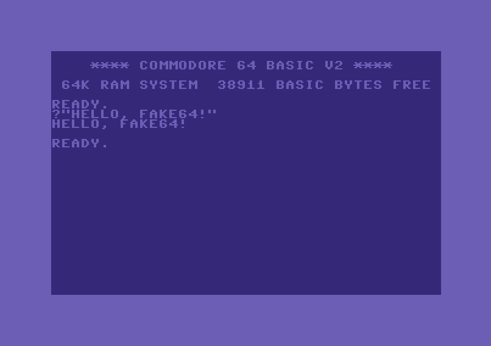

# Fake64

Un emulatore del Commodore 64 (PAL) in C#, scritto per essere letto: il codice ricalca la scheda madre
vera, con i chip MOS negli zoccoli, le piste che li collegano e i cavi verso monitor e tastiera.




## Cosa funziona

- **Avvio completo** con le ROM originali (KERNAL, BASIC, caratteri) fino a `READY.`, BASIC, programmi in
  linguaggio macchina, alla velocità di un C64 PAL (985.248 cicli al secondo, 50 frame al secondo).
- **CPU 6510 ciclo per ciclo**: un accesso al bus per ciclo, nello stesso ordine del chip (letture fittizie,
  doppia scrittura nelle istruzioni lettura-modifica-scrittura), tutti i 256 opcode compresi quelli non
  documentati, modo decimale, RDY e AEC, interrupt controllati all'ultimo ciclo. Verificata con il
  *6502 functional test* di Klaus Dormann e con le *SingleStepTests* di Tom Harte (vedi [Test](#test)).
- **VIC-II**: tutti i modi grafici (testo standard, multicolor, extended color; bitmap standard e multicolor),
  bordi 38/40 colonne e 24/25 righe, scroll fine, 8 sprite con espansione, multicolor, priorità e collisioni,
  raster interrupt, bad line con i 3 cicli di preavviso di BA. I cambi di registro a metà riga (split raster)
  cadono nel punto giusto con la precisione di un ciclo.
- **CIA 6526**: timer A e B (anche in cascata), TOD, interrupt, porte parallele; tastiera e banco del VIC-II
  collegati come sulla scheda.
- **Programmi `.prg`** (da riga di comando o trascinandoli sulla finestra): i programmi BASIC partono da soli.
- **Cartucce `.crt`**: Normal 8K/16K/Ultimax, Ocean, C64 Game System / System 3, Magic Desk, EasyFlash
  (in sola lettura).
- **Tastiera del PC** con mappatura posizionale, tasti funzione F1-F8 e tasti cursore.
- **Porte di controllo** (prese DE-9) con joystick, paddle e mouse 1351: i contatti digitali arrivano alla CIA 1,
  le linee POT al SID attraverso il commutatore analogico comandato dalla CIA 1. Nell'app il joystick si comanda
  dalla tastiera del PC o da un joystick/gamepad USB, i paddle dal mouse del PC.

Non ancora: audio del SID, drive 1541 e immagini disco/nastro (`.d64`, `.t64`), accessi DMA degli
sprite. Vedi [Limiti noti](#limiti-noti).

## Struttura

| Progetto | Contenuto |
|---|---|
| `src/Fake64.Mos` | I chip MOS come componenti autonomi: `MOS6502` (nucleo della CPU), `MOS6510` (CPU con porta di I/O), `MOS6526` (CIA), `MOS6569` (VIC-II PAL), `MOS6581` (SID). Ogni chip implementa la propria **piedinatura** (`I6510Pinout`, `I6526Pinout`, `I6569Pinout`, `I6581Pinout`) e non sa in quale computer è montato |
| `src/Fake64.C64` | La **scheda madre**: zoccoli, PLA, RAM, color RAM, ROM, matrice della tastiera, porta di espansione, uscita video |
| `src/Fake64.Prg` | Caricamento dei file `.prg` e scrittura nel buffer di tastiera del KERNAL |
| `src/Fake64.Crt` | Formato `.crt` e tipi di cartuccia |
| `src/Fake64.WinForms` | `C64Monitor` (lo schermo, uno UserControl) e `PcKeyboard` (il cavo della tastiera) |
| `src/Fake64` | L'app Windows: una finestra che ospita il monitor |
| `src/Fake64.Samples` | Generatore degli esempi: tokenizzatore BASIC V2, assembler 6502, writer `.crt` |
| `src/Fake64.Tests` | Test (MSTest) |
| `samples` | Programmi di esempio pronti da caricare, con i sorgenti BASIC e assembly commentati in `samples/src` |
| `tools` | Script di supporto (download delle suite di test della CPU) |

L'architettura è descritta in [docs/ARCHITETTURA.md](docs/ARCHITETTURA.md).

### Il modello fisico in codice

```csharp
var board = new Board(roms);                       // la scheda, con i chip di serie negli zoccoli

board.SidSocket.Remove();                          // si toglie il 6581...
board.SidSocket.Insert(new MySid());               // ...e si mette qualunque cosa con la piedinatura I6581Pinout
board.Reset();

var monitor = new C64Monitor { Dock = DockStyle.Fill };
form.Controls.Add(monitor);
var video = new MonitorCable(board.VideoOut, monitor);   // il cavo del monitor
var keys  = new PcKeyboard(monitor, board.Keyboard);     // il cavo della tastiera
```

Uno zoccolo vuoto si comporta come sul C64: il bus legge `$FF` e le linee restano inattive (il C64 si avvia
anche senza SID).

Le porte di controllo funzionano allo stesso modo: nella presa entra qualunque dispositivo che implementa i
pin della DE-9 (`IControlPortDevice`).

```csharp
var joystick = new Joystick();
board.ControlPort2.Plug(joystick);        // quasi tutti i giochi usano la porta 2
joystick.Fire = true;

board.ControlPort1.Plug(new Paddles { PositionA = 128 });   // Le Mans, REVS...
// oppure: board.ControlPort1.Plug(new Mouse1351());        // GEOS
```

## Compilare ed eseguire

Servono il [.NET 10 SDK](https://dotnet.microsoft.com/) e Windows per l'app (le librerie dei chip, della scheda
e dei formati sono `net10.0`).

```powershell
dotnet build src/Fake64.sln
dotnet run --project src/Fake64                      # avvio normale
dotnet run --project src/Fake64 -- gioco.prg         # carica un programma dopo l'avvio
dotnet run --project src/Fake64 -- cartuccia.crt     # avvia con una cartuccia inserita
```

Le ROM stanno in `src/Fake64/roms` (`kernal`, `basic`, `chargen`) e vengono copiate accanto all'eseguibile.
Sono le ROM originali del C64, protette da copyright.

### Esempi

La cartella [samples](samples/README.md) contiene una ventina di programmi pronti da trascinare sulla finestra,
ciascuno su un argomento del C64: BASIC, interrupt (raster, CIA, NMI), modo decimale, tutti i modi grafici del VIC-II,
sprite, scroll fine, banchi del VIC-II, joystick e paddle, cartucce (avvio automatico, Ultimax, banchi). I sorgenti
in `samples/src` sono BASIC e assembly 6502 commentato riga per riga: sono pensati per imparare.

```powershell
dotnet run --project src/Fake64 -- samples/rasterbars.prg
```

### Uso

- **Programmi e cartucce**: trascinare un `.prg` o un `.crt` sulla finestra. Un programma BASIC (anche con lo
  stub `SYS`, come la maggior parte dei giochi) parte con `RUN`; per il linguaggio macchina il titolo della
  finestra indica l'indirizzo da usare con `SYS`. Una cartuccia riavvia la macchina.
- **Tastiera**: i tasti arrivano al C64 quando il monitor ha il focus (un clic sul monitor glielo dà).
  La mappatura è posizionale, come in VICE: lo Shift del PC arriva al C64.

| Tasto del PC | Tasto del C64 |
|---|---|
| F1, F3, F5, F7 | F1, F3, F5, F7 |
| F2, F4, F6, F8 | Shift + F1, F3, F5, F7 |
| Freccia destra / giù | CRSR → / CRSR ↓ |
| Freccia sinistra / su | Shift + CRSR → / CRSR ↓ |
| Esc | RUN/STOP |
| Backspace | INST/DEL |
| `;` e `'` (a destra della L) | `:` e `;` |
| `\` | ↑ |

### Joystick e paddle

Clic destro sul monitor: per ciascuna porta di controllo si sceglie cosa è collegato. La scelta resta fra un
avvio e l'altro; il predefinito è il joystick dal tastierino nella porta 2, quella usata da quasi tutti i giochi.
**Scambia le porte** (Ctrl+F12) serve per i giochi che vogliono il joystick nella porta 1.

| Scelta | Comandi |
|---|---|
| Joystick: tastierino numerico | 8 su, 2 giù, 4 sinistra, 6 destra; 7, 9, 1, 3 diagonali; 0 o 5 fuoco (Bloc Num attivo) |
| Joystick: frecce, fuoco Ctrl | per i portatili senza tastierino; in questo modo le frecce non fanno da tasti cursore del C64 |
| Joystick USB | joystick o gamepad USB (API joystick di Windows): leva principale o pad direzionale, pulsanti 1-4 per il fuoco |
| Paddle: mouse | clic sul monitor per catturare il mouse, movimento orizzontale per girare la manopola, pulsante sinistro come pulsante del paddle, clic destro per liberarlo |

I tasti usati dal joystick non arrivano alla tastiera del C64. Una stessa origine può essere in una sola porta.

### Usare il C64 in un'altra applicazione

`C64Monitor` è un normale UserControl: si può mettere in qualunque form, anche insieme ad altri controlli.
Il monitor mantiene le proporzioni (`KeepAspectRatio`), riceve la tastiera solo quando ha il focus e offre
`CaptureFrame()` per una copia dell'ultimo frame. Per caricare file da codice:

```csharp
using Fake64.Crt;
using Fake64.Prg;

board.Enqueue(() => board.LoadPrg(File.ReadAllBytes("gioco.prg")));   // sul thread di emulazione
board.Enqueue(() => board.TypeText("RUN\r"));
board.Enqueue(() => board.InsertCartridge(CrtFile.Load("cartuccia.crt")));
```

## Test

```powershell
dotnet test src/Fake64.Tests
```

Circa 170 test propri: CPU (anche da sola, su un bus finto che registra ogni ciclo), CIA, VIC-II e grafica pixel
per pixel, zoccoli e piste, tastiera, monitor, programmi, cartucce, esempi, e avvio completo con KERNAL e BASIC.

Due suite esterne verificano la CPU contro il chip vero. Non sono nel repository (licenze GPL-3.0 e MIT); si
scaricano con:

```powershell
./tools/Download-CpuTests.ps1                 # entrambe (circa 1 GB)
./tools/Download-CpuTests.ps1 -SkipSingleStep # solo Klaus Dormann (pochi KB)
```

| Suite | Cosa verifica |
|---|---|
| [6502 functional test](https://github.com/Klaus2m5/6502_65C02_functional_tests) (Klaus Dormann, GPL-3.0) | Tutte le istruzioni documentate, i flag e il modo decimale |
| [SingleStepTests 6502](https://github.com/SingleStepTests/65x02) (Tom Harte, MIT) | 10.000 casi per opcode: stato finale **e accessi al bus ciclo per ciclo** |

Risultato attuale: il functional test arriva alla trappola di successo, e nelle SingleStepTests passano tutti i
237 opcode verificati (2.370.000 casi).

Senza i file i test corrispondenti risultano *Inconclusive*. Dalle SingleStepTests sono esclusi i 12 opcode
`JAM` e i 7 opcode instabili (`XAA`, `LXA`, `SHA`, `SHX`, `SHY`, `TAS`), il cui comportamento dipende dal
singolo chip.

## Limiti noti

- **SID**: i registri ci sono, l'audio non viene riprodotto.
- **Porte di controllo**: il mouse del PC non simula ancora il 1351; la penna ottica e il modo joystick del
  1351 non sono modellati. Il joystick USB è verificato solo nei test (conversione delle letture), non con
  tutti i dispositivi.
- **Drive 1541, `.d64`/`.t64`**: non ancora emulati.
- **VIC-II**: gli accessi DMA degli sprite non rubano cicli alla CPU; non si aprono i bordi con i trucchi
  delle demo; la grafica di una riga viene calcolata con i dati di memoria di fine riga (solo i cambi di
  registro sono precisi al ciclo).
- **CPU**: il reset legge subito il vettore invece di impiegare 7 cicli; non è modellato il ritardo degli
  interrupt dopo un salto condizionato preso senza cambio di pagina.
- **CIA**: non sono modellati i pin CNT, SP e FLAG; il TOD è contato internamente invece che dalla rete a 50 Hz.
- **EasyFlash**: in sola lettura (i giochi che salvano su flash non salvano).
