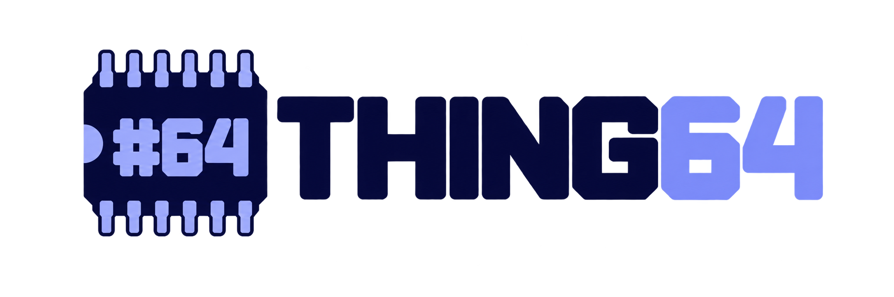
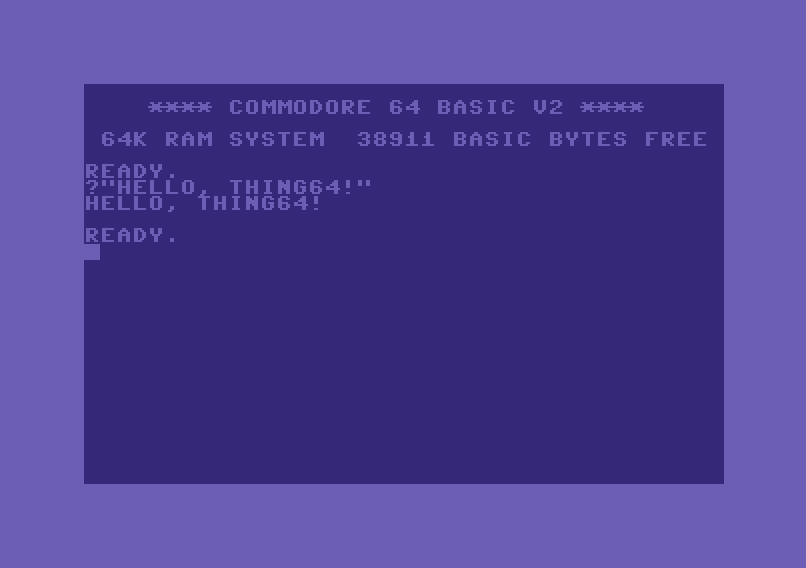
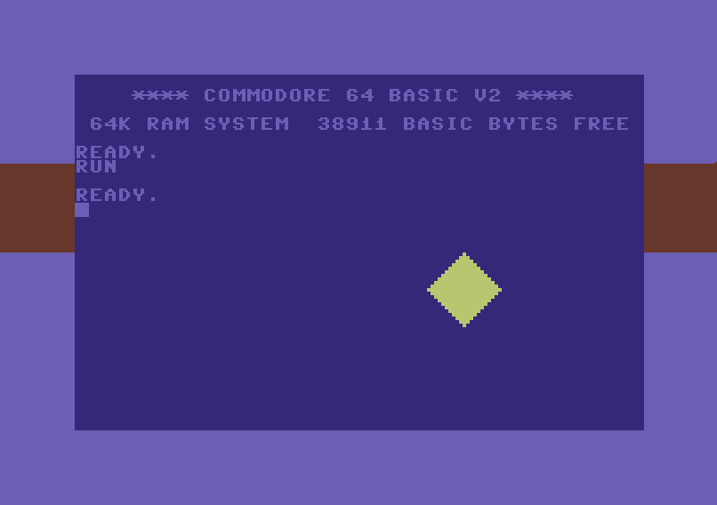

# Thing64

<p align="center">
  
</p>

*(formerly Fake64)*

A Commodore 64 (PAL) emulator in C#, written to be read: the code mirrors the real motherboard, with the MOS
chips in their sockets, the traces that connect them and the cables to the monitor, the speakers and the keyboard.
It comes with a studio in the browser to write 6502 assembly (and C) and run it right away.




## What works

- **Full boot** with the original ROMs (KERNAL, BASIC, characters) up to `READY.`, BASIC, machine language
  programs, at the speed of a PAL C64 (985,248 cycles per second, 50 frames per second).
- **Cycle-stepped 6510 CPU**: one bus access per cycle, in the same order as the chip (dummy reads, double write
  in read-modify-write instructions), all 256 opcodes including the undocumented ones, decimal mode, RDY and AEC,
  interrupts polled at the last cycle. Verified with Klaus Dormann's *6502 functional test* and Tom Harte's
  *SingleStepTests* (see [Tests](#tests)).
- **VIC-II**: all graphics modes (standard, multicolor and extended color text; standard and multicolor bitmap),
  38/40 column and 24/25 row borders, fine scrolling, 8 sprites with expansion, multicolor, priority and
  collisions, raster interrupt, bad lines with the 3 cycles of BA warning. Sprites steal their DMA cycles from the
  CPU (2 per sprite per line, plus the warning) and follow the chip's counters, so multiplexers work. The borders
  are the chip's two flip-flops: they open with the demo tricks (top and bottom by changing the rows between
  lines 248 and 250, sides by changing the columns at cycle 56), showing the idle byte and the sprites. Register
  changes in the middle of a line (raster splits) land at the right point with the precision of a cycle.
- **SID 6581**: three voices with 24-bit oscillators, triangle, sawtooth, pulse, noise (23-bit shift register),
  sync and ring modulation, ADSR envelopes with the chip's timing (the "ADSR bug" included), low/band/high-pass
  filter with resonance, `OSC3`/`ENV3`, 4-bit samples by writing the volume. Everything advances at every cycle;
  the board resamples the output to 44.1 kHz and the app plays it on the PC speakers.
- **CIA 6526**: timers A and B (cascaded too), TOD, interrupts, parallel ports; keyboard and VIC-II bank wired
  as on the board.
- **`.prg` programs** (from the command line, the studio or dragged onto a C64): BASIC programs start by themselves.
- **`.crt` cartridges**: Normal 8K/16K/Ultimax, Ocean, C64 Game System / System 3, Magic Desk, EasyFlash
  (read-only).
- **PC keyboard** with positional mapping, function keys F1-F8 and cursor keys.
- **Control ports** (DE-9 sockets) with joystick, paddles and 1351 mouse: the digital contacts reach CIA 1, the
  POT lines reach the SID through the analog switch driven by CIA 1. In the app the joystick is driven by the PC
  keyboard or by a USB joystick/gamepad, the paddles by the PC mouse.
- **Studio** (in the browser): projects, assembly editor (Monaco) with 6502 syntax highlighting, built-in
  assembler, editors for screens, charsets and sprites, F5 to build and run in the C64 tab. See
  [The web studio](#the-web-studio).
- **C**: a subset of C translated into assembly (`player.c` becomes `player.c.asm`), mixed freely with assembly
  modules. See [C](#c).

Not yet: the 1541 drive and disk/tape images (`.d64`, `.t64`). See [Known limits](#known-limits).

## Structure

| Project | Contents |
| --- | --- |
| `src/Thing64.Mos` | The MOS chips as standalone components: `MOS6502` (CPU core), `MOS6510` (CPU with I/O port), `MOS6526` (CIA), `MOS6569` (PAL VIC-II), `MOS6581` (SID). Each chip implements its own **pinout** (`I6510Pinout`, `I6526Pinout`, `I6569Pinout`, `I6581Pinout`) and does not know which computer it is mounted in |
| `src/Thing64.C64` | The **motherboard**: sockets, PLA, RAM, color RAM, ROMs, keyboard matrix, expansion port, control ports, video and audio outputs |
| `src/Thing64.Prg` | Loading `.prg` files and writing into the KERNAL keyboard buffer |
| `src/Thing64.Crt` | The `.crt` format and the cartridge types |
| `src/Thing64.Asm` | 6502/6510 assembler, ACME-compatible: labels, macros, loops, includes, expressions, errors with their file and line |
| `src/Thing64.Basic` | BASIC V2 tokenizer: a program in text becomes the `.prg` the C64 would have in memory |
| `src/Thing64.Graphics` | Pictures for the C64: PNG, the palette, the conversion of an image to bitmaps, character sets, tiles and sprites |
| `src/Thing64.C` | A C subset translated into ACME assembly: lexer with `#define`, parser, code generator, multiplication and division routines |
| `src/Thing64.Build` | From sources to C64 files: `.asm` and `.bas` to `.prg`, build manifests (`thing64.json`) with programs and cartridges |
| `src/Thing64.WinForms` | `C64Monitor` (the screen, a UserControl), `PcKeyboard` (the keyboard cable), `PcSpeakers` (the speakers), joystick and paddle simulators |
| `src/Thing64.Computer` | The desktop app: one C64 in a window (`ComputerForm`), loading of `.prg`/`.crt`, the ROMs, the settings |
| `src/Thing64` | The `thing64` command line (Spectre.Console), a .NET global tool: `run`, `asm`, `basic`, `build` |
| `src/Thing64.WebComputer` | The C64 in the browser: the same board compiled to WebAssembly (Blazor, AOT), on a canvas |
| `src/Thing64.WebStudio` | The studio in the browser (Blazor Server): projects in a local folder, Monaco, builds, the web computer |
| `src/Thing64.Tests` | Tests (MSTest) |
| `samples` | Sample programs ready to load, with the commented BASIC and assembly sources in `samples/src` |
| `tools` | Helper scripts (download of the CPU test suites) |

The architecture is described in [docs/ARCHITECTURE.md](docs/ARCHITECTURE.md).

### The physical model in code

```csharp
var board = new Board(roms);                       // the board, with the stock chips in the sockets

board.SidSocket.Remove();                          // take the 6581 out...
board.SidSocket.Insert(new MySid());               // ...and put in anything with the I6581Pinout pinout
board.Reset();

var monitor = new C64Monitor { Dock = DockStyle.Fill };
form.Controls.Add(monitor);
var video = new MonitorCable(board.VideoOut, monitor);        // the monitor cable
var keys  = new PcKeyboard(monitor, board.Keyboard);          // the keyboard cable
var audio = new AudioCable(board.AudioOut, new PcSpeakers()); // the audio cable to the PC speakers
```

An empty socket behaves as on the C64: the bus reads `$FF` and the lines stay inactive (the C64 boots without a
SID too).

The control ports work the same way: any device that implements the DE-9 pins (`IControlPortDevice`) fits the
socket.

```csharp
var joystick = new Joystick();
board.ControlPort2.Plug(joystick);        // almost every game uses port 2
joystick.Fire = true;

board.ControlPort1.Plug(new Paddles { PositionA = 128 });   // Le Mans, REVS...
// or: board.ControlPort1.Plug(new Mouse1351());            // GEOS
```

## Building and running

You need the [.NET 10 SDK](https://dotnet.microsoft.com/) and Windows for the C64 window (the chip, board, format
and assembler libraries are `net10.0`).

```powershell
dotnet build src/Thing64.slnx
./tools/Install-Tool.ps1          # packs the command line and installs it as the global tool "thing64"
```

Then, from any folder:

```powershell
thing64 run game.prg                # one C64 window running a program (or a .crt, or a source built first)
thing64 asm main.asm --labels main.labels   # assembles to main.prg; labels in VICE format
thing64 basic hello.bas             # tokenizes to hello.prg
thing64 build samples/samples.json  # builds every output of a build manifest
thing64 --help
```

Without installing the tool, the same commands work with `dotnet run --project src/Thing64 -- ...` (after a build
of the solution, so that the desktop app is there).

A .NET tool cannot use Windows Forms, so the command line is `net10.0` and starts the desktop app
(`Thing64.Computer.exe`, a C64 in a window), which travels inside the tool package in its `desktop` folder. The ROMs are in
`src/Thing64.Computer/roms` (`kernal`, `basic`, `chargen`) and are copied next to the desktop app. They are the
original C64 ROMs, protected by copyright: the tool package contains them, so keep it for yourself.

### The C64 in the browser

`src/Thing64.WebComputer` runs the same board and chips in the browser: Blazor WebAssembly hosts them, the page
drives the board one frame at a time (`requestAnimationFrame`) and paints the frames on a canvas. Keys are
positional as in the desktop app; programs and cartridges are loaded with a button or dropped on the screen.
The SID plays through Web Audio (an AudioWorklet), starting at the first click or key on the screen. The joystick
goes into port 2 (or 1) and moves with the numeric keypad, or the arrows with Ctrl as fire, and with any gamepad
(Gamepad API).

```powershell
dotnet run --project src/Thing64.WebComputer              # development server on http://localhost:5164
dotnet publish src/Thing64.WebComputer -c Release -o out  # static site in out/wwwroot
```

The Release build is compiled ahead of time to WebAssembly (it needs `dotnet workload install wasm-tools`). It makes
all the difference: measured in Edge on the development PC, the emulation can run at about 2.9 times real time
with AOT, at 0.18 times without (Debug builds are interpreted, so they run slowly).

The C64 ROMs are copyrighted and are not part of the published site: the first time, the page asks for the three
files (`kernal`, `basic`, `chargen`) and keeps them in the browser. Debug builds embed them, for development.

### The web studio

`src/Thing64.WebStudio` is the studio as a web app: a Blazor Server app (styled with Tailwind, in the colors of the
logo) where projects, files, the assembler and the builds run on the server, the editor is Monaco and the C64 is the
web computer, in WebAssembly, in a tab next to the files (or in a window of its own).

- **Projects** are the folders of a projects folder (`Studio:ProjectsFolder` in `appsettings.json`, by default
  `D:\Configurations\Thing64\Studio\Projects`), with everything inside: sources, the build manifest `thing64.json`
  and the built programs. *Create project* makes a folder with a `main.asm` that starts with RUN and its manifest.
- **Files**: a tree with new file, new folder, rename and delete; one editor tab per open file.
- **F7** builds the manifest (or, without one, the open source); errors are marked on their line. **F5** builds,
  runs the first output and shows the C64 tab; a double click on a `.prg` or `.crt` runs it. **Ctrl+S** saves.
- **Graphics**: the image button imports a picture (any format) as a PNG and a `.gfx.json` asset, which opens in
  the graphics editor: the picture and how the C64 will show it side by side, the mode (hires or multicolor bitmap,
  characters, sprites), fit, dithering, palette, the shared colors, the limit of characters and the tiles. Every
  build converts the assets again and writes their data files and an include (`name.inc.asm`, with a label on each
  part and constants for the colors), so the assembly never falls behind the picture.
- **Editor regions** ("code behind"): data in a source can be marked for a visual editor with comment lines,
  which the assembler ignores. Above the first one Monaco shows "✎ Edit"; saving the editor rewrites only the
  `.byte` lines of the region. The screen editor edits what the C64 shows: screen codes and colors, painted with
  a pen that is a character and a color (bit 3 of the color: a multicolor character), through a charset of its own:
  ```asm
  ;@ screen  width=40 height=25 screen=room1__screen colors=room1__colors
  ;@         charset=charset1__characters first=$70 background=5 multicolor=1 multicolor1=$0E multicolor2=$01
  room1__screen:   .byte $70,$20,...      ; 1000 screen codes, for $0400
  room1__colors:   .byte $0E,$0D,...      ; 1000 colors, for $D800
  ;@ end
  ```
  The charset editor edits the characters of a charset (a file of its own, shared by the screens that name it),
  each shown as the screens use it (its cells' color, hires or multicolor); adding, duplicating, deleting or dragging
  characters renumbers the screen codes of those screens:
  ```asm
  ;@ charset first=$70
  charset1__characters:    .byte $FF,$57,$57,$57,$57,$57,$57,$FF ; $70 wall A
  charset1__charactersEnd:
  ;@ end
  ```
  The parameters are numbers or symbols, resolved by assembling the project: the editor sees the bytes the C64 sees.
  The second editor is for sprites: every label of the region starts a sprite, hires and multicolor mixed, and the
  animations declared in it play next to them. Copy puts a sprite on the clipboard as a picture, Ctrl+V converts a
  picture from the clipboard (another sprite, or any image) into the selected one:
  ```asm
  ;@ sprites    color=7 background=6 multicolor1=11 multicolor2=1
  ;@ animation  walk frames=spriteWalk1,spriteWalk2 speed=8
  spriteWalk1:  .byte ...
  ;@ multicolor=1 color=5
  spriteBat:    .byte ...
  ;@ end
  ```
  Sprites can be added, duplicated, renamed (in every source of the project) and deleted, slid in the four
  directions; animations created, renamed and deleted, frames added and removed, speeds changed.
  Two older editors remain for projects that use tile tables: `;@ tilemap` (a map of logical tiles drawn through
  a tile → screen code and a tile → color table) and `;@ charmap` (those tables and their characters).
- **Binary files** open in a hex viewer: 16 bytes per row in hex and as characters (ASCII, PETSCII or screen
  codes), C64 addresses for a `.prg`, header and chips (bank, address) for a `.crt`, every base of the selected byte
  and the word starting there. **PNG pictures** open as a picture (zoom, the pixel under a click and its nearest C64
  color), as their structure (the chunks, IHDR decoded) or as bytes.
- **`_structure.md`**: every new project has one, the map of the project (files, memory, conventions, regions);
  RalfAI reads it before working and keeps it up to date.
- **RalfAI**, on the right, is an assistant that works on the project: it reads and writes its files, builds it
  (and fixes the errors it gets) and runs it in the C64. The conversation is kept in the project (`.ralfai/`).
  Files can be attached to a message (the button, dropped on the chat, pictures pasted): they are saved in
  `.ralfai/attachments/`; text goes into the message, pictures are looked at with the `Image_Look` tool.
- **The C64 tab** keeps running while a file is shown. *Own window* moves the C64 to a window of its own (a second
  monitor); closing that window brings it back into the tab.

```powershell
dotnet publish src/Thing64.WebComputer -c Release -o artifacts/web   # the C64, once (and after changing it)
dotnet run --project src/Thing64.WebStudio                           # http://localhost:5180
```

The studio serves the published web computer at `/computer/` (`Studio:ComputerFolder`): it must be the AOT build,
the only one fast enough. The first time the C64 asks for its ROMs, then the browser keeps them.

RalfAI comes from a local NuGet feed (`nuget.config`: `D:\Dev\NuGetLocalFeed`), and reads its providers, models and
keys from its own configuration file (`Assistant:ConfigPath`, outside the repository); the model is the one of the
`thing64` context (`Assistant:ContextKey`).

### C

A project is not "assembly" or "C": the two mix file by file. The entry point stays an assembly file (the one in the
manifest, with the BASIC stub and the origin), and every `.c` file is a module that an assembly file includes.
Builds (`thing64 build`, the web studio) translate every `.c` file of the project into a `.c.asm` next to it, before
assembling: an assembly module includes it with `.source "player.c.asm"`. The `.c.asm` is written again only when
the `.c` is newer than it (or the translator is), and never by hand. Functions and global variables keep their
names, so assembly and C call each other and share variables (`JSR readControls`, `LDA grounded`).

The constants of the assembly are seen by the C with `__equ`, so that a value is written once:

```c
__equ char PLAYER_COLOR;      // PLAYER_COLOR = 1 in the assembly
__equ char* SCREEN;           // SCREEN = $0400
...
SCREEN[0] = PLAYER_COLOR;     // LDA #PLAYER_COLOR / STA SCREEN
```

An `__equ` is a value, not a variable: it becomes an immediate operand (`LDA #PLAYER_COLOR`), it cannot be changed
or have its address taken, and a pointer one is followed like a hardware register (`SCREEN[i]`, `*SCREEN`).

```c
#define BORDER (*(char*)0xD020)

char grounded = 1;
int score;

void addPoints(char points) {
    score += points;
    if (score > 999) BORDER = 2;
}
```

It is a real C subset, thought for the 6502:

- `char` (8 bits, unsigned) and `signed char`, `int` (16 bits, signed) and `unsigned int`, pointers and
  one-dimensional arrays, strings (in PETSCII); constants take the type of the other operand, so `char` arithmetic
  stays 8 bits.
- `if`/`else`, `while`, `do`, `for`, `break`, `continue`, `return`, `?:`, `&&`, `||`, all the arithmetic, bitwise,
  shift and compound assignment operators, `++`/`--`, casts, `sizeof`; `#define` without parameters.
- **No recursion**: parameters and locals live at fixed addresses (`function__name`), so a call costs a few stores
  and a `JSR`; a recursive call is an error. Values come back in A (8 bits) or A/X (16 bits).
- Hardware registers are pointers to constants: `*(char*)0xD020 = 2` is `STA $D020`; `__asm("SEI")` inserts
  assembly; `__equ` declares a constant defined in the assembly.
- `*`, `/` and `%` by powers of two are shifts and masks; otherwise they call 16-bit routines, added only when used.
- Not supported: `long`, `float`, `struct`, `switch`, `goto`, function pointers, arrays of arrays, macros with
  parameters; `__zp` (variables in zero page) is reserved.

Errors carry the file and the line of the C source, like the assembler's. The FanCMission test (the player module
of a platform game rewritten in C) behaves exactly like its assembly original: 325 bytes instead of 214, and about
25% more cycles.

### Samples

The [samples](samples/README.md) folder holds about twenty programs, each on a C64 topic: BASIC, interrupts
(raster, CIA, NMI), decimal mode, all the VIC-II graphics modes, sprites, fine scrolling, VIC-II banks, open
borders, SID sound, joystick and paddles, cartridges (autostart, Ultimax, banks). The sources in `samples/src` are
BASIC and 6502 assembly commented line by line: they are meant for learning.

```powershell
thing64 run samples/rasterbars.prg
thing64 build samples/samples.json   # rebuilds them from samples/src
```

### Using a C64

- **Programs and cartridges**: drag a `.prg` or a `.crt` onto a C64. A BASIC program (also with the `SYS` stub,
  like most games) starts with `RUN`; for machine language the tab title shows the address to use with `SYS`.
  A cartridge restarts the machine.
- **Keyboard**: the keys reach the C64 while the monitor has the focus (a click on the monitor gives it).
  The mapping is positional, as in VICE: the PC Shift reaches the C64.

| PC key | C64 key |
| --- | --- |
| F1, F3, F5, F7 | F1, F3, F5, F7 |
| F2, F4, F6, F8 | Shift + F1, F3, F5, F7 |
| Right / down arrow | CRSR → / CRSR ↓ |
| Left / up arrow | Shift + CRSR → / CRSR ↓ |
| Esc | RUN/STOP |
| Backspace | INST/DEL |
| `;` and `'` (right of L) | `:` and `;` |
| `\` | ↑ |

### Joystick and paddles

Right click on the monitor: for each control port you choose what is connected. The choice is kept between runs;
the default is the keypad joystick in port 2, the one almost every game uses. **Swap ports** (Ctrl+F12) is for
the games that want the joystick in port 1. The same menu has **Audio** (mute) and **Reset**.

| Choice | Controls |
| --- | --- |
| Joystick: numeric keypad | 8 up, 2 down, 4 left, 6 right; 7, 9, 1, 3 diagonals; 0 or 5 fire (Num Lock on) |
| Joystick: arrows, fire Ctrl | for laptops without a keypad; in this mode the arrows are not the C64 cursor keys |
| USB joystick | USB joystick or gamepad (Windows joystick API): main stick or directional pad, buttons 1-4 for fire |
| Paddles: mouse | click on the monitor to capture the mouse, horizontal movement turns the knob, left button is the paddle button, right click releases it |

The keys used by the joystick do not reach the C64 keyboard. A source can be in one port only.

### Using the C64 in another application

`C64Monitor` is a normal UserControl: it can go into any form, together with other controls. The monitor keeps
its proportions (`KeepAspectRatio`), receives the keyboard only when it has the focus and offers `CaptureFrame()`
for a copy of the last frame. To load files from code:

```csharp
using Thing64.Crt;
using Thing64.Prg;

board.Enqueue(() => board.LoadPrg(File.ReadAllBytes("game.prg")));   // on the emulation thread
board.Enqueue(() => board.TypeText("RUN\r"));
board.Enqueue(() => board.InsertCartridge(CrtFile.Load("cartridge.crt")));
```

`Board.Stop()` stops the emulation thread; `Board.FastForward(time)`, called on the emulation thread, runs the
given time as fast as possible (the studio uses it for the KERNAL boot).

## Tests

```powershell
dotnet test src/Thing64.Tests
```

About 270 tests of its own: CPU (also alone, on a fake bus that records every cycle), CIA, VIC-II and graphics
pixel by pixel, sprite DMA and open borders, SID and audio output, sockets and traces, keyboard, control ports and
simulators, monitor, assembler, command line, programs, cartridges, samples, and full boot with KERNAL and BASIC.

Two external suites check the CPU against the real chip. They are not in the repository (GPL-3.0 and MIT
licenses); they are downloaded with:

```powershell
./tools/Download-CpuTests.ps1                 # both (about 1 GB)
./tools/Download-CpuTests.ps1 -SkipSingleStep # only Klaus Dormann (a few KB)
```

| Suite | What it checks |
| --- | --- |
| [6502 functional test](https://github.com/Klaus2m5/6502_65C02_functional_tests) (Klaus Dormann, GPL-3.0) | All the documented instructions, the flags and decimal mode |
| [SingleStepTests 6502](https://github.com/SingleStepTests/65x02) (Tom Harte, MIT) | 10,000 cases per opcode: final state **and bus accesses cycle by cycle** |

Current result: the functional test reaches its success trap, and in the SingleStepTests all the 237 checked
opcodes pass (2,370,000 cases).

Without the files the matching tests are *Inconclusive*. The 12 `JAM` opcodes and the 7 unstable opcodes
(`XAA`, `LXA`, `SHA`, `SHX`, `SHY`, `TAS`), whose behaviour depends on the individual chip, are excluded from the
SingleStepTests.

## Known limits

- **SID**: filter and mixer, which are analog on the 6581, are approximated: the cutoff frequency follows the
  datasheet's linear formula (the real curve varies from chip to chip), combined waveforms are the AND of the bits
  (weaker on the chip), the filter distortion is missing. The EXT IN input and the 8580 are not modelled.
- **Control ports**: the PC mouse does not simulate the 1351 yet; the light pen and the 1351 joystick mode are
  not modelled. The USB joystick is verified only in the tests (conversion of the readings), not with every device.
- **1541 drive, `.d64`/`.t64`**: not emulated yet.
- **VIC-II**: the graphics of a line are computed with the memory contents at the end of the line (only register
  changes are cycle exact); the sequencer is "idle" outside the 200 display lines instead of following its
  counters, so FLD, FLI, VSP and linecrunch do not work; sprite crunch and the light pen are not modelled.
- **CPU**: reset reads the vector at once instead of taking 7 cycles; the interrupt delay after a taken branch
  that does not cross a page is not modelled.
- **CIA**: the CNT, SP and FLAG pins are not modelled; the TOD is counted internally instead of from the 50 Hz
  mains.
- **EasyFlash**: read-only (games that save to flash do not save).
- **C**: no recursion, no `long`, `float`, `struct` or `switch`; the code is about 50% larger and 25% slower
  than hand-written assembly (no peephole optimizer yet).
- **Studio editor**: Monaco is loaded from the jsDelivr CDN, so the first start needs an internet connection.
- **Browser C64**: no paddles or mouse, no studio; Debug builds are too slow (interpreted).
