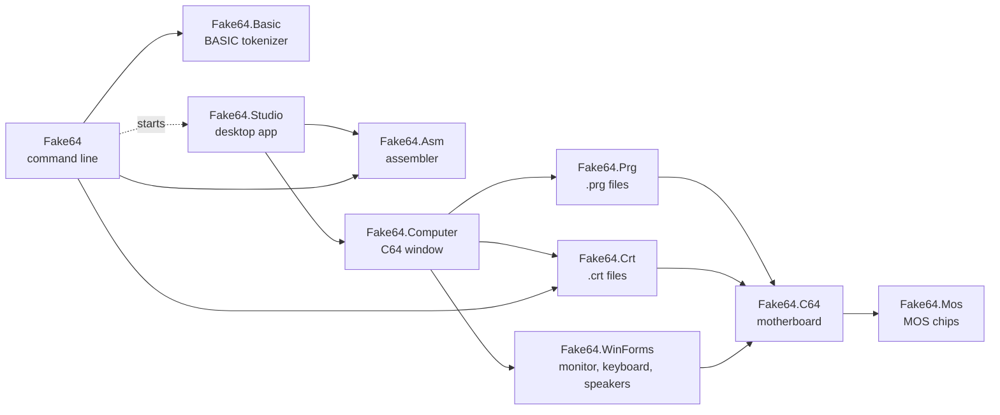
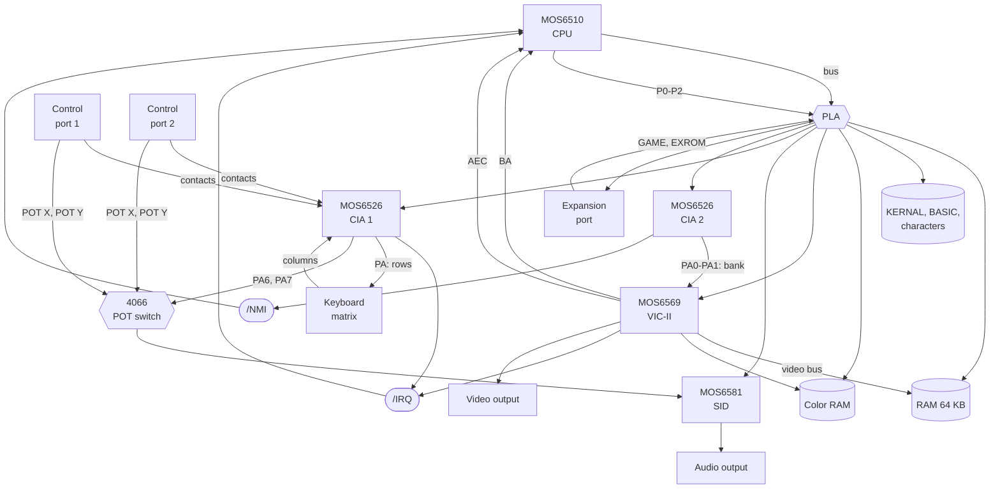

# Fake64 architecture

Fake64 represents in code the physical setup of the Commodore 64: standalone MOS chips, a motherboard with sockets
and traces, cables to the monitor, the speakers and the keyboard. Each piece knows only what the real component
would know.

## Project dependencies

- **`Fake64.Mos`** depends on nothing: a `MOS6526` could sit in a 1571 drive, a `MOS6502` in any computer.
  The chips are used only through their pinout.
- **`Fake64.C64`** knows no file formats, WinForms or `System.Drawing`. It receives the ROMs as bytes
  (`SystemRoms`), hands the frames to an `IScreen` and the audio samples to an `ISpeaker`.
- **`Fake64.Asm`** depends on nothing either: it turns source text into bytes.

## Chips and pinouts

Each chip implements an interface that lists its pins, grouped. It is the contract of the socket: any object that
implements it "fits" the socket, like an electrically compatible chip.

| Pinout | Chip | Main pins |
| --- | --- | --- |
| `I6510Pinout` (DIP-40) | `MOS6510` | bus (A0-A15, D0-D7, R/W), /IRQ, /NMI, RDY, AEC, port P0-P5, /RES, φ2 |
| `I6526Pinout` (DIP-40) | `MOS6526` | registers (RS0-RS3), ports PA and PB, /IRQ, /RES, φ2 |
| `I6569Pinout` (DIP-40) | `MOS6569` | registers (A0-A5), video bus (A0-A13, D0-D11), /IRQ, BA, AEC, video output |
| `I6581Pinout` (DIP-28) | `MOS6581` | registers (A0-A4), POT X/Y, audio output (instantaneous level), /RES, φ2 |

The model is **transactional**: address, data, R/W and chip select are grouped into `Read`/`Write` (the chip is
called only when it is selected); the clock is `Tick`; the control lines are properties, with active-low lines
expressed as "true = active".

The parallel ports (`ParallelPort`) have a latch, a direction register and pins: outputs are what was written to
the latch, inputs read what whoever is connected to the pin supplies (`External`), with pull-ups at 1.

## The motherboard

| Connection | Implementation |
| --- | --- |
| /IRQ, /NMI | `OpenCollectorLine`: low if at least one connected output pulls it down |
| Sockets | `Socket<TPinout>`: `Insert`, `Remove`; when a chip is inserted the board wires its pins (`Board.Wiring.cs`) |
| Memory map | `Board.Pla.cs`: combines LORAM/HIRAM/CHAREN with GAME/EXROM (normal, 8K, 16K, Ultimax modes) |
| VIC-II bank | PA0/PA1 of CIA 2, inverted; recomputed when the port changes |
| Keyboard | columns read from CIA 1 port B depending on the rows selected by port A |
| Control ports | `ControlPort` with an `IControlPortDevice` (the DE-9 pins). The contacts of port 1 go to CIA 1 port B, those of port 2 to port A; NMOS outputs can be pulled to ground from outside (`ParallelPort.Pins` is an AND), which is why a joystick in port 1 produces phantom keys |
| POT lines | POT X and POT Y of port 1 or 2, selected by PA6/PA7 of CIA 1 (4066 switch), go into the SID, which updates `$D419`/`$D41A` every 512 cycles |
| Devices | `Joystick` (5 contacts), `Paddles` (two potentiometers, buttons on the left and right pins), `Mouse1351` (position mod 64 on the POT lines, buttons on fire and up) |
| Serial bus | with no drive connected, CLK IN and DATA IN reflect the C64's outputs, inverted |

## The clock cycle

`Board.ExecuteCycle` runs one φ2 cycle:

1. reads the VIC-II's **BA**, which concerns the current cycle;
2. `Tick` of CIA 1, CIA 2 and SID; the level of the SID's audio output goes to the audio socket (`AudioPort`);
3. `Tick` of the CPU, which stops by itself if RDY or AEC require it;
4. `Tick` of the VIC-II, which closes the cycle: at the end of the last cycle of a line it completes the line,
   updates the raster, handles the raster interrupt and, at the end of a frame, sends the picture to the video
   output.

The VIC-II generates its own timing (63 cycles per line, 312 lines per frame).

In real time the clock runs on a dedicated thread: it emulates the cycles needed to keep up with the clock
(985,248 Hz) and sleeps 1 ms when it is in step, with the Windows timer resolution at 1 ms. Other threads act on
the machine with `Board.Enqueue`, which runs the action between two cycles. `Board.Stop` ends the thread;
`Board.FastForward` runs some emulated time at full speed and then resumes the real-time pacing from there.

## The CPU

`MOS6502` is the core, `MOS6510` extends it with the I/O port at `$0000`/`$0001`.

- **Opcode table** (`MOS6502.Opcodes.cs`): mnemonic and addressing mode for the 256 opcodes; the kind of access
  (implied, read, write, read-modify-write, branch, special) follows from the operation.
- **Cycle-stepped engine** (`MOS6502.Cycles.cs`): every `Tick` is one cycle with exactly one bus access.
  The address calculation cycles are shared by all instructions of the same mode; then the operand access
  depends on the kind (a read; a write; read, write back of the original value, write of the result).
- **Operations** (`MOS6502.Operations.cs`, `MOS6502.Instructions.cs`): what each instruction does to the data,
  without bus accesses; decimal mode as on the NMOS 6502.
- **RDY and AEC**: with RDY low the CPU stops at the first read cycle (writes go on); with AEC low the bus
  belongs to someone else and the CPU is halted.
- **Interrupts**: /NMI is sampled at every cycle and triggers on the falling edge; /IRQ is level triggered. The
  request is evaluated at the start of the last cycle of the instruction: after `CLI` one more instruction runs,
  an IRQ active during `SEI` is served. The vector is chosen at the fourth cycle of the sequence, so an NMI can
  take the place of a `BRK` or of an IRQ.

## The VIC-II

- **Raster**: the VIC-II counts cycles and lines. On bad lines (lines `$30`-`$F7` whose 3 low bits match
  YSCROLL, if the display was on at line `$30`) BA goes low at cycle 12 and AEC at cycle 15 (counting from 1),
  up to cycle 54.
- **Sprites** (`MOS6569.Sprites.cs`): each sprite has two fixed cycles to read its pointer and data (sprites 0-2
  in cycles 58-63, sprites 3-7 in cycles 1-10 of the next line). If the sprite's DMA is on, BA goes low 3 cycles
  earlier and AEC in the two access cycles: one sprite costs the CPU 5 cycles per line, all 8 cost 19.
  The DMA follows the chip's counters: it starts at cycles 55-56 if Y matches the raster, MCBASE advances at
  cycles 15-16 (every other line with vertical expansion) and the DMA stops at 63. At cycle 58 the data row to
  show on the next line is latched. Changing Y in the middle of a sprite does not move it: that is how
  multiplexers work.
- **Borders**: two flip-flops as in the chip. The vertical one is set when the raster line equals the bottom
  (251/247) and cleared at the top (51/55) with DEN on, checked at cycle 63 and at the left compare; the main one
  is set at the right compare (X 344/335) and cleared at the left one (X 24/31) if the vertical one is clear.
  The compares are equalities, so the demo tricks open the borders. The border advances together with
  `CatchUp`, over the pixels already output, with the registers of the moment.
- **Rendering** (`MOS6569.Graphics.cs`): into a frame buffer of color indexes (403 x 284). The VIC-II outputs
  8 pixels per cycle: when the CPU writes a register, the pixels of the line already output are drawn with the
  old values (`CatchUp`), and the rest of the line, at the end of the line, with the new ones. Graphics, sprites
  and collisions are computed per line. Outside the display lines the graphics are those of the idle sequencer
  (the byte at `$3FFF` of the bank, `$39FF` in extended color), visible only with open borders.
- **Video output**: at the end of a frame the VIC-II calls `FrameCompleted`; the board passes the picture to
  `VideoPort`, which copies it into the monitor connected with the `MonitorCable`
  (`IScreen.BeginRender`/`EndRender`, 32-bit BGRA).

## The SID

- **Voices** (`MOS6581.Voice.cs`): at every cycle the 24-bit accumulator advances by the frequency; the 12-bit
  waveforms come from the accumulator (sawtooth: the high 12 bits; triangle: folded by bit 23, XORed with the
  previous voice for ring modulation; pulse: compare with the width) or from the noise shift register, which
  advances on the edge of bit 19. SYNC clears the accumulator when the previous voice's one starts over. The TEST
  bit holds the oscillator still.
- **Envelope**: a 15-bit counter compared for equality with the period of the phase (9-31251 cycles per step);
  linear attack, decay and release with steps getting longer below `$5D`, `$36`, `$1A`, `$0E`, `$06`. The
  equality reproduces the "ADSR bug": if the period gets shorter, the counter wraps all the way around.
- **Filter and mixer**: state-variable filter updated at every cycle, as in reSID; the voices routed into the
  filter come out of the selected low-, band- or high-pass, the others go straight through (voice 3 can be
  silenced with "3 OFF"). The mixer has a DC component that the volume scales together with the voices: that is
  why writing `$D418` makes sound, the 4-bit sample trick.
- **Output** (the board's `AudioPort`): averages the cycles of each sample (exact integer resampling), removes the
  DC component with a 16 Hz high-pass, like the output capacitor, and sends 10 ms blocks to the `ISpeaker`
  connected with an `AudioCable`. Without a speaker the sampling costs nothing.

## Outside the board

- **`Fake64.Prg`**: `LoadPrg` writes the program straight into RAM (under the ROMs too, through `Board.Ram`) and,
  if the address is the start of BASIC, updates the pointers like `LOAD`; `TypeText` uses the KERNAL keyboard
  buffer.
- **`Fake64.Crt`**: `CrtFile` reads the header and the `CHIP` packets and creates the right cartridge type
  (`BankedCartridge` and derived classes). The board knows only the abstract `Cartridge` class: GAME/EXROM lines,
  ROML, ROMH, I/O 1, I/O 2.
- **`Fake64.Asm`**: `Assembler` is a multi-pass 6502 assembler (labels, constants, expressions with precedence,
  automatic zero page, directives `.byte .word .text .screen .fill .basic`). Errors are `AssemblerException`s with
  the line and the reason, so that the editor can mark them. `Assembler.Mnemonics`, `Assembler.Directives` and
  `InstructionSet.Descriptions` feed the editor's syntax highlighting and hover help.
- **`Fake64.Basic`**: `BasicTokenizer` turns BASIC V2 text into the C64 in-memory format with the KERNAL rules.
- **`Fake64.Crt`** also writes `.crt` files (`CrtWriter`), used to build cartridges from assembled banks.
- **`Fake64.WinForms`**: `C64Monitor` implements `IScreen` with a fixed-size bitmap guarded by a lock (written by
  the emulation thread, painted by the UI thread); `PcKeyboard` translates the PC keys with `PcKeyboardLayout` and
  passes them to `Keyboard.SetPressedKeys`, holding very short taps for at least 40 ms so that the KERNAL sees
  them. `PcSpeakers` implements `ISpeaker` with `waveOut` (`winmm`): it starts when the queue holds ~50 ms of
  audio and keeps it at that level by dropping or repeating one sample per block, because the emulation clock and
  the sound card clock never quite agree.
- **Simulators** (`Fake64.WinForms`): they drive a control port device with the PC input. `KeyboardJoystick`
  (keypad or arrows + Ctrl), `UsbJoystick` (Windows joystick API, `winmm`, read every 10 ms) and `MousePaddles`
  (horizontal movement of the captured mouse). `ControlPortSelector` decides what is connected to each port,
  creates device and simulator, provides the menu items and the keys to keep away from the C64 keyboard
  (`PcKeyboard.Excluded`).

## The desktop app (`Fake64.Computer`, `Fake64.Studio`)

- **`StudioForm`**: the main window, an MDI container. Its children (editors and C64s) are shown maximized, with
  a `TabControl` at the bottom used as the tab strip and kept in sync with the active child. Menu shortcuts are
  disabled while a C64 tab is active, so that keys like F5 reach the C64.
- **`FileExplorer`**: one folder at a time in a `ListView`, with shell icons, a `FileSystemWatcher`, label edit for
  renaming, the recycle bin for deleting and drag and drop for moving. The last folder goes into the settings.
- **`AsmEditorForm`**: a WebView2 that serves `Studio/Editor` (editor page and script) from a virtual host and loads
  Monaco from the CDN. The page and the form talk with web messages: the page sends the text at every change and
  the editor commands (save, assemble, run); the form sends the initial text, the language lists and the error
  markers. Assembling writes the `.prg` next to the source; running asks the studio for the editor's C64.
- **`MainFiles`**: the file F5/F7 assemble: the main file set for the folder, or the file found by following the
  `!source` lines up to the one nobody includes.
- **`ComputerForm`** (`Fake64.Computer`): one C64 (board, monitor, keyboard, speakers, control ports), as a tab or
  as a window of its own. It runs programs with `MediaLoader.Run`: reset, KERNAL boot with `FastForward`, load,
  then `RUN` or `SYS`. Closing it stops the board.
- **`AppSettings`** (`Fake64.Computer`): one shared instance saved in `%AppData%\Fake64\settings.json` (control
  ports, audio, last folder, window placement, main files).
- **`Program`** (`Fake64.Studio`): `Fake64.Studio.exe [path]` opens the studio, `--computer [file]` a single C64
  window; Shift+F5 in the studio starts the same executable with `--computer`.

## The command line (`Fake64`)

`fake64` is built with Spectre.Console and packaged as a .NET global tool (`tools/Install-Tool.ps1`).

- **`asm`, `basic`, `build`** run in the command line itself: `ProgramBuilder` turns a `.asm` or `.bas` into a
  `.prg`; `BuildManifest` reads a JSON manifest that lists the outputs (programs, and cartridges made of assembled
  banks) with paths relative to it. `samples/samples.json` is the manifest of the samples, and the tests check that
  the files in `samples/` are the ones it builds.
- **`studio`, `run`** start the desktop app as a separate process (`Desktop`), so that the terminal is free again.
  A .NET tool cannot use Windows Forms, so the command line is `net10.0` and the tool package carries the desktop
  app, published into its `desktop` folder when the tool is packed. While developing, the command line finds it in
  the build output of `src/Fake64.Studio`.
