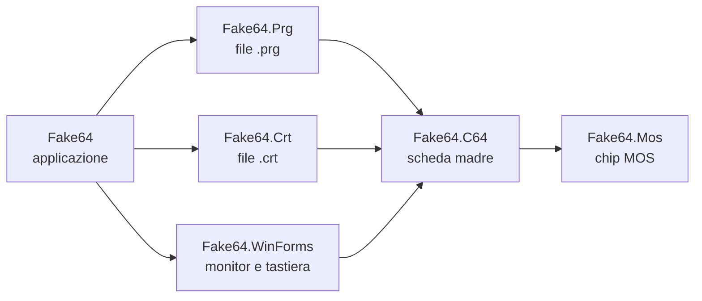
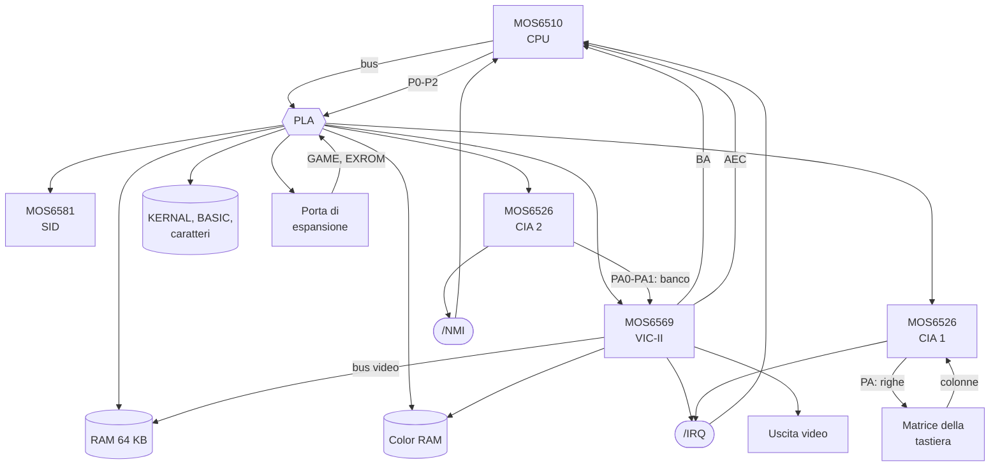

# Architettura di Fake64

Fake64 rappresenta in codice la situazione fisica del Commodore 64: chip MOS autonomi, una scheda madre con
zoccoli e piste, cavi verso monitor e tastiera. Ogni pezzo conosce solo ciò che conoscerebbe il componente vero.

## Dipendenze fra i progetti

- **`Fake64.Mos`** non dipende da nulla: un `MOS6526` potrebbe stare in un drive 1571, un `MOS6502` in qualunque
  computer. I chip si usano solo attraverso la loro piedinatura.
- **`Fake64.C64`** non conosce formati di file, WinForms o `System.Drawing`. Riceve le ROM come byte
  (`SystemRoms`) e consegna i frame a un `IScreen`.

## Chip e piedinature

Ogni chip implementa un'interfaccia che elenca i suoi pin, raggruppati. È il contratto dello zoccolo: qualunque
oggetto che la implementa "entra" nello zoccolo, come un chip compatibile elettricamente.

| Piedinatura | Chip | Pin principali |
|---|---|---|
| `I6510Pinout` (DIP-40) | `MOS6510` | bus (A0-A15, D0-D7, R/W), /IRQ, /NMI, RDY, AEC, porta P0-P5, /RES, φ2 |
| `I6526Pinout` (DIP-40) | `MOS6526` | registri (RS0-RS3), porte PA e PB, /IRQ, /RES, φ2 |
| `I6569Pinout` (DIP-40) | `MOS6569` | registri (A0-A5), bus video (A0-A13, D0-D11), /IRQ, BA, AEC, uscita video |
| `I6581Pinout` (DIP-28) | `MOS6581` | registri (A0-A4), uscita audio, /RES, φ2 |

Il modello è **a transazioni**: indirizzo, dati, R/W e chip select sono raggruppati in `Read`/`Write` (il chip
viene interpellato solo quando è selezionato); il clock è `Tick`; le linee di controllo sono proprietà, con le
linee attive basse espresse come "true = attiva".

Le porte parallele (`ParallelPort`) hanno latch, registro di direzione e pin: le uscite valgono quanto scritto nel
latch, gli ingressi leggono ciò che fornisce chi è collegato al pin (`External`), con i pull-up a 1.

## La scheda madre

| Collegamento | Implementazione |
|---|---|
| /IRQ, /NMI | `OpenCollectorLine`: bassa se almeno un'uscita collegata la tira giù |
| Zoccoli | `Socket<TPinout>`: `Insert`, `Remove`; inserendo un chip la scheda ne collega i pin (`Board.Wiring.cs`) |
| Mappa di memoria | `Board.Pla.cs`: combina LORAM/HIRAM/CHAREN con GAME/EXROM (modi normale, 8K, 16K, Ultimax) |
| Banco del VIC-II | PA0/PA1 della CIA 2, invertiti; ricalcolato quando la porta cambia |
| Tastiera | colonne lette dalla porta B della CIA 1 in base alle righe selezionate dalla porta A |
| Bus seriale | senza drive collegati, CLK IN e DATA IN riflettono le uscite del C64 invertite |

## Il ciclo di clock

`Board.ExecuteCycle` esegue un ciclo di φ2:

1. legge **BA** del VIC-II, che riguarda il ciclo in corso;
2. `Tick` di CIA 1, CIA 2 e SID;
3. `Tick` della CPU, che si ferma da sola se RDY o AEC lo richiedono;
4. `Tick` del VIC-II, che chiude il ciclo: alla fine dell'ultimo ciclo di una riga completa la riga,
   aggiorna il raster, gestisce il raster interrupt e, a fine frame, invia l'immagine all'uscita video.

Il VIC-II genera da sé la temporizzazione (63 cicli per riga, 312 righe per frame).

In tempo reale il clock gira su un thread dedicato: emula i cicli che mancano per stare al passo con
l'orologio (985.248 Hz) e dorme 1 ms quando è in pari, con la risoluzione del timer di Windows a 1 ms.
Gli altri thread agiscono sulla macchina con `Board.Enqueue`, che esegue l'azione fra due cicli.

## La CPU

`MOS6502` è il nucleo, `MOS6510` lo estende con la porta di I/O a `$0000`/`$0001`.

- **Tabella degli opcode** (`MOS6502.Opcodes.cs`): mnemonico e modo di indirizzamento per i 256 opcode; il tipo
  di accesso (implicito, lettura, scrittura, lettura-modifica-scrittura, salto, speciale) deriva dall'operazione.
- **Motore ciclo per ciclo** (`MOS6502.Cycles.cs`): ogni `Tick` è un ciclo con esattamente un accesso al bus.
  I cicli di calcolo dell'indirizzo sono comuni a tutte le istruzioni dello stesso modo; poi l'accesso
  all'operando dipende dal tipo (una lettura; una scrittura; lettura, riscrittura del valore originale,
  scrittura del risultato).
- **Operazioni** (`MOS6502.Operations.cs`, `MOS6502.Instructions.cs`): cosa fa ogni istruzione sul dato,
  senza accessi al bus; modo decimale come sul 6502 NMOS.
- **RDY e AEC**: con RDY basso la CPU si ferma al primo ciclo di lettura (le scritture proseguono); con AEC
  basso il bus è di un altro e la CPU è ferma.
- **Interrupt**: /NMI viene campionato a ogni ciclo e scatta sul fronte di discesa; /IRQ è a livello. La
  richiesta viene valutata all'inizio dell'ultimo ciclo dell'istruzione: dopo `CLI` viene eseguita ancora
  un'istruzione, un IRQ attivo durante `SEI` viene servito. Il vettore si sceglie al quarto ciclo della
  sequenza, quindi un NMI può prendere il posto di un `BRK` o di un IRQ.

## Il VIC-II

- **Raster**: il VIC-II conta cicli e righe. Nelle bad line (righe `$30`-`$F7` con i 3 bit bassi uguali a
  YSCROLL, se il display era attivo alla riga `$30`) BA scende al ciclo 12 e AEC al ciclo 15 (contando da 1),
  fino al ciclo 54.
- **Rendering** (`MOS6569.Graphics.cs`): in un frame buffer di indici colore (403 x 284). Il VIC-II emette
  8 pixel per ciclo: quando la CPU scrive un registro, i pixel della riga già emessi vengono disegnati con i
  valori vecchi (`CatchUp`), e il resto della riga, a fine riga, con quelli nuovi. Grafica, sprite, collisioni
  e bordi sono calcolati per riga.
- **Uscita video**: a fine frame il VIC-II chiama `FrameCompleted`; la scheda passa l'immagine a `VideoPort`,
  che la copia nel monitor collegato con il `MonitorCable` (`IScreen.BeginRender`/`EndRender`, 32 bit BGRA).

## Fuori dalla scheda

- **`Fake64.Prg`**: `LoadPrg` scrive il programma direttamente in RAM (anche sotto le ROM, tramite `Board.Ram`) e,
  se l'indirizzo è l'inizio del BASIC, aggiorna i puntatori come `LOAD`; `TypeText` usa il buffer di tastiera
  del KERNAL.
- **`Fake64.Crt`**: `CrtFile` legge intestazione e pacchetti `CHIP` e crea il tipo di cartuccia giusto
  (`BankedCartridge` e derivate). La scheda conosce solo la classe astratta `Cartridge`: linee GAME/EXROM,
  ROML, ROMH, I/O 1, I/O 2.
- **`Fake64.WinForms`**: `C64Monitor` implementa `IScreen` con una bitmap a dimensione fissa protetta da un lock
  (scritta dal thread di emulazione, disegnata dal thread della UI); `PcKeyboard` traduce i tasti del PC con
  `PcKeyboardLayout` e li passa a `Keyboard.SetPressedKeys`, tenendo premuti almeno 40 ms i tocchi brevissimi
  perché il KERNAL li veda.
